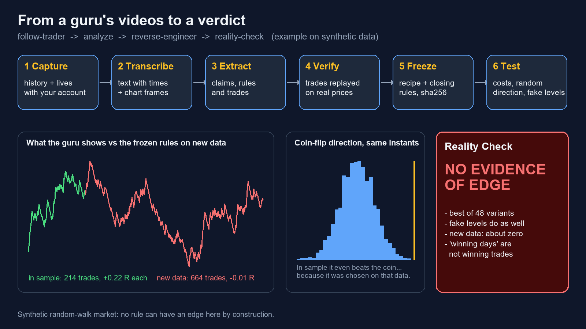

# Goodbye FuffaGuru — Verifica il tuo guru del trading

[](LICENSE)
[](pyproject.toml)
[](CLAUDE.md)

*Fuffa*: in italiano, fumo, aria fritta. [English version](README.md).

Prima di affidare i tuoi soldi a un «guru» del trading di TikTok, YouTube o Instagram, controlla con
i dati se quello che insegna e mostra batte davvero il caso. Qui trovi il metodo, gli strumenti e le
lezioni che abbiamo imparato facendolo noi.



## Costruito su dati veri, non su opinioni

Non è uno script fatto in un fine settimana. Nasce da mesi di lavoro quotidiano in un laboratorio
privato di ricerca quantitativa, che sviluppa, mette alla prova e fa girare in demo le proprie
strategie con le stesse regole che trovi qui.

| Cosa abbiamo analizzato | Quanto |
|---|---|
| Video e dirette di trading trascritti e analizzati | **circa 290 ore** (≈ 800 video da oltre 70 canali YouTube, più dirette su TikTok e YouTube e reel di Instagram) |
| Idee di strategia estratte da quel materiale | **circa 300**: solo **18** erano abbastanza precise da poterle provare |
| Idee che hanno retto ai costi veri e ai controlli contro il caso | **nessuna** |
| Trader seguiti dal vivo, operazione per operazione | diversi, su mercati diversi (oro, indici USA, Forex), con le operazioni dal vivo verificate **tick per tick** sui dati dei future |
| Ricette preregistrate costruite da quello che quei trader insegnano e fanno | **più di una dozzina**, tutte chiuse da regole scritte *prima* dei numeri |

Ogni prova usa i costi veri del broker, ingressi a caso negli stessi istanti, livelli finti, un
periodo di conferma successivo e uno strumento affine. Il metodo completo è in
[docs/METHOD.md](docs/METHOD.md), i casi anonimi in [docs/CASE_STUDIES.md](docs/CASE_STUDIES.md).

**Perché lo pubblichiamo:** troppe persone pagano corsi, gruppi di segnali e «conti gestiti» venduti
con le schermate delle giornate vincenti. Poche ore con questi strumenti dicono più di qualsiasi
testimonianza. L'obiettivo è semplice: **verifica prima di pagare**.

## Perché esiste

I social sono pieni di trader che vendono corsi, gruppi di segnali e «mentorship» con il 90-100% di
operazioni vincenti. Per mesi abbiamo trasformato quei contenuti in regole e operazioni verificabili,
e le abbiamo controllate sui prezzi veri e con i costi veri. Gli strumenti che ci sono serviti sono
qui, ripuliti e generici: così chiunque può fare lo stesso prima di pagare qualcuno, e senza
ingannare sé stesso.

## Avvio rapido con Claude Code (5 righe)

```
git clone https://github.com/proof-over-hype/goodbye-fuffaguru && cd goodbye-fuffaguru
claude                                            # apre Claude Code nella cartella
/setup                                            # controlla Python, ffmpeg, yt-dlp; crea .venv; chiede da quale browser leggere il tuo accesso
/follow-trader https://www.tiktok.com/@qualcuno   # storico + sorveglianza delle live (ogni 60 s)
/reality-check qualcuno                           # dopo qualche live: il verdetto in una pagina
```

Poi basta parlare con Claude: *«segui questi trader»*, *«analizza la live di ieri»*, *«ricava il suo
metodo e mettilo alla prova»*. Regole, comandi e sotto-agenti sono in [CLAUDE.md](CLAUDE.md) e in
[.claude/](.claude).

## Avvio rapido senza Claude Code

```
python scripts/bootstrap.py                       # .venv + dipendenze + configurazione guidata
.venv/bin/python examples/synthetic_guru/run_example.py   # su Windows: .venv\Scripts\python
python -m fuffaguru verify mie_operazioni.csv mie_barre.csv --cost 0.3 --report REALITY_CHECK.md
python -m fuffaguru follow https://www.youtube.com/@UnCanale --history --limit 20
python -m fuffaguru watch --background && python -m fuffaguru status
```

Serve anche [ffmpeg](https://ffmpeg.org/download.html) nel PATH per fotogrammi e registrazioni.
I dati di mercato non sono inclusi: servono barre a 1 minuto (o più fini) tue.

## Il metodo in 6 passi

1. **Raccogliere** solo materiale pubblico, con il proprio account, per un'analisi personale ([CAPTURE.md](docs/CAPTURE.md), in inglese).
2. **Trascrivere** con i tempi (faster-whisper) ed **estrarre i fotogrammi** (ffmpeg): i prezzi stanno sui grafici.
3. **Estrarre** affermazioni, regole e operazioni — prese, scartate, solo disegnate, solo raccontate — con i
   [modelli di prompt](fuffaguru/prompts).
4. **Verificare** le operazioni sui prezzi veri (barre a 1 minuto o tick): quel prezzo è stato scambiato? dov'era lo stop? cosa è successo dopo?
5. **Scrivere la ricetta e preregistrarla**: impronta sha256 e regole di chiusura *prima* di qualunque numero.
6. **Metterla alla prova**: costi veri, direzione a caso negli stessi istanti, livelli finti, un periodo
   successivo, uno strumento affine, la ricetta senza il suo filtro chiave.

Dettagli ed errori statistici tipici (data snooping, scelta a posteriori, percentuale di vincite contata
a giornate): [docs/METHOD.md](docs/METHOD.md). Un esempio completo con dati sintetici:
[examples/synthetic_guru](examples/synthetic_guru): la migliore di 48 varianti guadagna +0,22 R a
operazione sui dati su cui è stata scelta, batte perfino la direzione a caso, e su dati nuovi dà circa zero.

## Cosa abbiamo trovato

In forma anonima e prudente: sono i risultati delle *regole come vengono insegnate* e delle *operazioni
come vengono mostrate*, messe alla prova da noi. Non dicono nulla sulle intenzioni di nessuno.
Racconto completo: [docs/CASE_STUDIES.md](docs/CASE_STUDIES.md).

- **Decine di strategie, nessuna ha retto.** Dai video di una ventina di canali YouTube e di due account
  TikTok abbiamo estratto circa 300 idee; le 18 abbastanza complete da essere provate non hanno retto ai
  costi veri e al confronto con ingressi a caso. Più di una dozzina di ricette preregistrate, costruite dai
  trader seguiti dal vivo, sono state tutte chiuse da regole scritte prima dei numeri.
- **Le regole insegnate non battono il caso.** Le zone vere arrivano all'obiettivo quanto quelle finte
  (per esempio 17,8% contro 15,6%, p = 0,24; fuori da ogni zona: 22,3%).
- **«90%+ di vincite» contava le giornate in positivo, non le operazioni.** Il diario per operazione era
  nettamente più basso. Una percentuale mensile era la somma delle percentuali di più conti.
- **Il guadagno per operazione cala** nel solo diario onesto che abbiamo trovato: un risultato per
  operazione che si riduce nel giro di poche settimane.
- **Insegnato in un modo, operato in un altro.** Dal vivo: altri strumenti, altri orari, stop più larghi,
  una conferma d'ingresso che nelle lezioni non c'è.
- **I risultati dal vivo:** un periodo nettamente positivo, il successivo circa a zero.
- **Verso giusto, stop sbagliato.** Alcune operazioni dal vivo in una sola sessione, tutte chiuse in stop, mentre l'obiettivo è
  arrivato più tardi in tutte: lo stop stava dentro il rumore normale, appena oltre massimi non ancora presi.
- **Gli esempi sono scelti dopo.** Nelle lezioni non si vedono quasi mai perdite vere.
- **Promesse e realtà.** diverse operazioni a settimana promesse; nessuna eseguita in un'intera giornata di diretta.
- **Uno stop più largo migliora tutto, anche i livelli a caso.** Ha alzato la quota di obiettivi presi da
  circa 18% a circa 30%, allo stesso modo sui livelli finti e in altri orari: il «posto» del trader non c'entrava.

## La checklist prima di investire o abbonarsi

- [ ] C'è un risultato verificato da terzi (estratti del broker, 6-12 mesi, perdite comprese)?
- [ ] La percentuale di vincite è **per operazione**, con guadagno e perdita medi in R?
- [ ] Hai visto sessioni intere con ingressi e uscite veri, non solo clip?
- [ ] Le regole insegnate coincidono con le operazioni fatte dal vivo?
- [ ] Le regole sono abbastanza precise da scriverle, o la parte decisiva è «nel corso»?
- [ ] I risultati sono al netto di spread, commissioni e slittamento?
- [ ] Il risultato è stabile nel tempo, o si restringe?
- [ ] Qualcun altro le ha messe alla prova contro ingressi a caso e livelli finti, su un periodo successivo?

Altri segnali d'allarme, con il modo di controllarli: [docs/RED_FLAGS.md](docs/RED_FLAGS.md). Le lezioni
dalle operazioni perse che abbiamo visto: [docs/LESSONS.md](docs/LESSONS.md).

## Seguire un trader: storico e dirette

- `follow` aggiunge un account; `history` scarica lo storico pubblico (video, short, reel, clip, dirette
  passate) a 720p, lo trascrive, estrae i fotogrammi e poi cancella il video.
- `watch` controlla ogni 60 secondi se un account è in diretta e la registra in pezzi da 3 minuti,
  trascrivendo man mano. Quando l'indirizzo firmato scade, riparte nella stessa sessione; chiude solo dopo
  3 controlli negativi di fila. Più dirette si registrano insieme. Se la pagina dice «in diretta» ma non
  si trova un flusso valido, arriva un avviso invece del silenzio.
- `install-autostart` fa ripartire la sorveglianza dopo un riavvio; `status` mostra account, dirette ed errori.
- Dopo l'analisi, `clean` cancella video e fotogrammi e tiene trascrizione, CSV delle operazioni, rapporto
  e un'immagine con i fotogrammi chiave. Senza rapporto e CSV non cancella niente. Sotto i 20 GB liberi non
  si registra e non si scarica.
- Instagram live è **sperimentale** e non provato su una diretta vera: vedi [docs/CAPTURE.md](docs/CAPTURE.md).

## Cosa c'è nel repository

```
fuffaguru/            pacchetto Python (MIT)
  capture/            account seguiti, storico, sorveglianza e registrazione delle live, pulizia
  transcribe.py       faster-whisper con i tempi
  frames.py           fotogrammi e provini con ffmpeg
  trades.py           schema CSV delle operazioni, verifica sulle barre OHLC
  prereg.py           congela una ricetta (JSON/YAML) con sha256 e data; registro delle prove
  nulltests.py        direzione a caso, livelli finti, bootstrap, p-value, costi in R
  report.py           il rapporto «Reality Check» in markdown
  prompts/            modelli di prompt: operazioni, regole, ricetta
docs/                 METHOD, RED_FLAGS, CASE_STUDIES, LESSONS, CAPTURE (in inglese)
examples/             esempio sintetico + modello del CSV delle operazioni
.claude/              comandi e sotto-agenti di Claude Code;  CLAUDE.md: le regole per l'agente
tests/                pytest (python -m pytest)
```

## Avvertenze legali: da leggere

- **Non è consulenza finanziaria.** È uno strumento educativo. Niente qui ti dice di comprare, vendere o investire.
- **Termini delle piattaforme e diritto d'autore.** Sei tu responsabile del rispetto dei termini di servizio
  di ogni piattaforma e della legge del tuo paese (diritto d'autore, privacy, registrazioni). Cattura solo
  per la tua analisi personale, con il tuo account, e **non ripubblicare mai** video, fotogrammi o
  trascrizioni di altri.
- **Nessuna accusa.** I rapporti descrivono regole messe alla prova e operazioni verificate, non persone.
  Una ricetta tradotta che non supera la prova non dimostra che qualcuno non sappia operare o sia in mala fede.
  Se condividi i risultati, tienili anonimi, resta sui dati e chiedi un parere legale prima di fare nomi.
- **I tuoi dati restano tuoi.** I cookie restano nel tuo browser o in `secrets/`; le catture in `data/`.
  Entrambe le cartelle sono escluse da git.

## Contribuire

Nuovi casi anonimi, test contro il caso, correzioni per le piattaforme e traduzioni sono benvenuti: vedi
[CONTRIBUTING.md](CONTRIBUTING.md). Licenza: [MIT](LICENSE).
