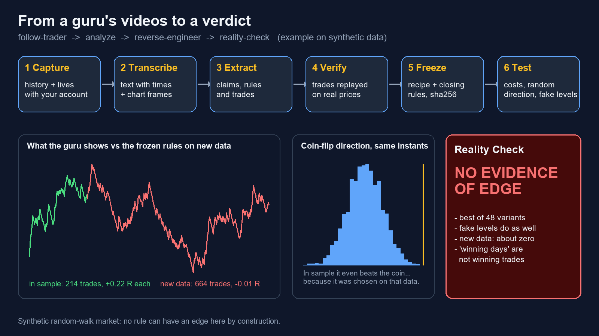

# Goodbye FuffaGuru — Reality-check your trading guru

[](LICENSE)
[](pyproject.toml)
[](CLAUDE.md)

*Fuffa* is Italian slang for hot air: smoke and mirrors. [Leggi in italiano](README.it.md).

Before you give your money to a trading "guru" from TikTok, YouTube or Instagram, check with data
whether what they teach and show actually beats chance. This repository gives anyone the method,
the tools and the lessons we learned doing exactly that.



## Why it exists

Social media are full of traders selling courses, signal groups and "mentorships" with 90-100% win
rates. We spent months turning that content into testable rules and trades, and checking them on
real prices with real costs. The tools we built for it are here, cleaned up and generic, so that
you can do the same before you pay anyone, and so that you don't fool yourself either.

## Quickstart with Claude Code (5 lines)

```
git clone https://github.com/proof-over-hype/goodbye-fuffaguru && cd goodbye-fuffaguru
claude                                            # open Claude Code in this folder
/setup                                            # checks Python, ffmpeg, yt-dlp; creates .venv; asks which browser you are logged in with
/follow-trader https://www.tiktok.com/@someone    # history + live watcher (every 60 s)
/reality-check someone                            # after some lives: the one-page verdict
```

Then just talk to Claude: *"follow these traders"*, *"analyze yesterday's live"*, *"reverse-engineer
their method and test it"*. The project rules, commands and sub-agents are in [CLAUDE.md](CLAUDE.md)
and [.claude/](.claude).

## Quickstart without Claude Code

```
python scripts/bootstrap.py                       # .venv + dependencies + guided setup
.venv/bin/python examples/synthetic_guru/run_example.py   # Windows: .venv\Scripts\python
python -m fuffaguru verify my_trades.csv my_bars.csv --cost 0.3 --report REALITY_CHECK.md
python -m fuffaguru follow https://www.youtube.com/@SomeChannel --history --limit 20
python -m fuffaguru watch --background && python -m fuffaguru status
```

You also need [ffmpeg](https://ffmpeg.org/download.html) on your PATH for frames and recording.
Market data are not included: bring your own 1-minute (or finer) bars.

## The method in 6 steps

1. **Collect** only what is public, with your own account, for personal analysis ([CAPTURE.md](docs/CAPTURE.md)).
2. **Transcribe** with timestamps (faster-whisper) and **extract frames** (ffmpeg): charts carry the prices.
3. **Extract** claims, rules and trades — taken, skipped, only drawn, only told — with the
   [prompt templates](fuffaguru/prompts).
4. **Verify** the trades on real prices (1-minute bars or ticks): did that price trade, where was the stop, what happened next.
5. **Write the recipe and preregister it**: sha256 fingerprint and closing rules *before* any number.
6. **Test it**: real costs, random direction at the same instants, fake levels, a later period, a related
   instrument, the recipe without its key filter.

Details and the usual statistical traps (data snooping, choosing after the fact, win rate by days):
[docs/METHOD.md](docs/METHOD.md). A complete run on synthetic data:
[examples/synthetic_guru](examples/synthetic_guru) — the best of 48 variants makes +0.22 R per trade in
sample, even beats random direction, and gives about zero on new data.

## What we found

Anonymous and cautious: these are results of *rules as taught* and *trades as shown*, tested by us.
They say nothing about anyone's intentions. Full write-up: [docs/CASE_STUDIES.md](docs/CASE_STUDIES.md).

- **Dozens of strategies, none held.** From the videos of about two dozen YouTube channels and two TikTok
  accounts we extracted about 300 ideas; the 18 complete enough to test did not survive real costs and a
  random-entry control. More than a dozen preregistered recipes built from traders followed live were
  all closed by rules written before the numbers.
- **The rules taught did not beat chance.** Real zones hit the target about as often as fake ones
  (e.g. 17.8% vs 15.6%, p = 0.24; trades outside any zone: 22.3%).
- **"90%+ win rate" counted green days, not trades.** The trade-level journal was markedly lower. A
  monthly percentage was the sum of several accounts' percentages.
- **The result per trade shrank** in the only honest journal we found: a shrinking per-trade result over a few weeks.
- **Taught one way, traded another.** Live: other instruments, other hours, wider stops, an entry
  confirmation not in the lessons.
- **Live results:** one period clearly positive, the following period about flat.
- **Right direction, wrong stop.** A handful of live trades in one session were all stopped out, while the target was
  reached later in all of them: the stops sat inside normal noise, just beyond untaken highs.
- **Examples are chosen afterwards.** Lessons showed almost no real losses.
- **Promises vs observation.** several trades a week promised; none taken in a full day of live streaming.
- **A wider stop improves everything — even random levels.** It raised the share of targets hit from
  about 18% to about 30%, identically on fake levels and at other hours: the trader's "place" was not the reason.

## Checklist before you invest or subscribe

- [ ] A track record verified by a third party (broker statements, 6-12 months, losses included)?
- [ ] Win rate **per trade**, with average win and loss in R?
- [ ] Full sessions with real entries and exits, not only clips?
- [ ] Do the rules taught match the trades done live?
- [ ] Are the rules precise enough to write down, or is the key part "in the course"?
- [ ] Results after spread, commission and slippage?
- [ ] Stable over time, or shrinking?
- [ ] Tested by someone else against random entries and fake levels, on a later period?

More flags, with how to check each one: [docs/RED_FLAGS.md](docs/RED_FLAGS.md). Lessons from losing
trades we watched: [docs/LESSONS.md](docs/LESSONS.md).

## What is in the repository

```
fuffaguru/            Python package (MIT)
  capture/            follow profiles, history download, live watcher and recorder, cleaning
  transcribe.py       faster-whisper with timestamps
  frames.py           frames and contact sheets with ffmpeg
  trades.py           trade CSV schema, verification on OHLC bars
  prereg.py           freeze a recipe (JSON/YAML) with sha256 and time; trial log
  nulltests.py        random direction, fake levels, bootstrap, p-values, costs in R
  report.py           the "Reality Check" markdown report
  prompts/            LLM prompt templates: trades, rules, recipe
docs/                 METHOD, RED_FLAGS, CASE_STUDIES, LESSONS, CAPTURE, LAUNCH
examples/             synthetic example + trades CSV template
.claude/              Claude Code commands and sub-agents;  CLAUDE.md: rules for the agent
tests/                pytest (python -m pytest)
```

## Legal notes — please read

- **Not financial advice.** This is an educational tool. Nothing here tells you to buy, sell or invest in anything.
- **Platform terms and copyright.** You are responsible for respecting the terms of service of each
  platform and the law of your country (copyright, privacy, recording). Capture only for your personal
  analysis, with your own account, and **never republish** videos, frames or transcripts of others.
- **No accusations.** Reports describe tested rules and verified trades, not people. A failed test of a
  translated recipe does not prove that someone has no skill or acted in bad faith. If you share results,
  keep them anonymous, stick to data, and get legal advice before naming anyone.
- **Your data stay yours.** Cookies stay in your browser or in `secrets/`; captures in `data/`. Both are ignored by git.

## Contributing

New anonymous case studies, null tests, platform fixes and translations are welcome: see
[CONTRIBUTING.md](CONTRIBUTING.md). Licence: [MIT](LICENSE).
